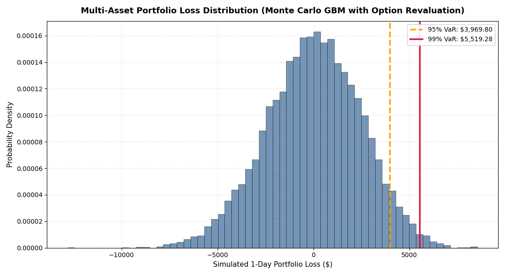

# Multi-Asset Market Risk Engine

[](https://www.python.org/)
[](https://opensource.org/licenses/MIT)

A modular Python engine that estimates **1-day Value at Risk (VaR)** and **Expected Shortfall (ES)** for a three-asset equity portfolio with an equity-option overlay, using three methods and comparing the results:

1. **Historical Simulation**
2. **Parametric (Variance-Covariance)**
3. **Monte Carlo Simulation** using correlated Geometric Brownian Motion (GBM), with the option **repriced in every scenario** using Black-Scholes

The project is built to show the full workflow of a market-risk analysis: data acquisition, return calculation, three risk methodologies, derivative revaluation, and interpretation of the differences between methods.

---

## Results

Portfolio: $100,000 split 50% Apple (AAPL), 30% Microsoft (MSFT), 20% S&P 500 index (^GSPC), plus a 10% allocation to an out-of-the-money AAPL call option (strike 5% above spot, 6 months to expiry). Horizon: 1 trading day. Data: Yahoo Finance, 2023-01-01 to 2026-01-01. Risk-free rate: FRED `TB3MS`.

==============================================================================================
Methodology                      | Conf   | VaR ($)      | VaR (%)  | ES ($)       | ES (%)
----------------------------------------------------------------------------------------------
Historical Simulation            | 95%    | $1,926.60    | 1.93  % | $2,718.76    | 2.72  %
Historical Simulation            | 99%    | $3,149.53    | 3.15  % | $4,441.96    | 4.44  %
Parametric (Variance-Covariance) | 95%    | $2,034.78    | 2.03  % | $2,551.69    | 2.55  %
Parametric (Variance-Covariance) | 99%    | $2,877.82    | 2.88  % | $3,297.02    | 3.30  %
Monte Carlo Simulation           | 95%    | $3,969.80    | 3.61  % | $4,870.40    | 4.43  %
Monte Carlo Simulation           | 99%    | $5,519.28    | 5.02  % | $6,307.73    | 5.73  %
==============================================================================================


*Simulated 1-day portfolio P&L from 10,000 Monte Carlo scenarios. Positive values on the x-axis are losses; negative values are gains. The dashed and solid vertical lines mark the 95% and 99% VaR.*

### What the results show

- **The distribution is roughly bell-shaped and centred near zero**, as expected for a one-day horizon where drift is tiny compared with volatility.
- **It is not symmetric.** The gain side (negative losses) stretches further than the loss side. This comes from the long call option: its payoff is convex, so it gains more when Apple rises than it loses when Apple falls by the same amount.
- **The 99% VaR is about 1.39 times the 95% VaR** ($5,519 vs $3,970). For a pure normal distribution the ratio is 2.326 / 1.645 = 1.41. The close match is a reminder that GBM draws normally distributed shocks, so this model **cannot produce fat tails**. Real equity returns have heavier tails, which is why historical VaR at 99% is often higher than parametric or Monte Carlo VaR.
- _Add your own comparison here once the table is filled in: do the three methods agree? Which is highest at 99%? How does the option change Monte Carlo VaR compared with a stocks-only run? How might 2023-2025 being a mostly calm, rising market lower the historical estimate?_

---

## Key Concepts

**Value at Risk (VaR)** answers: "What is the loss that will not be exceeded on X% of days?" A 1-day 95% VaR of $4,000 means that on 95 days out of 100 the loss should be smaller than $4,000.

**Expected Shortfall (ES)**, also called Conditional VaR, answers the follow-up: "On the bad days that exceed VaR, how large is the loss on average?" ES looks inside the tail, which VaR does not, and is the measure used in Basel's Fundamental Review of the Trading Book.

---

## Methodology

### 1. Historical Simulation

Take the actual daily portfolio returns over the data window, sort them, and read off the percentile.

- VaR = negative of the return at the (1 − confidence) percentile
- ES = average of the returns worse than that percentile

No distribution is assumed, but the method can only reflect events that occurred in the sample window. Options are **not** included in this method.

### 2. Parametric (Variance-Covariance)

Assume portfolio returns are normally distributed with zero mean over one day.

$$\sigma_p = \sqrt{w^\top \Sigma w}, \qquad \text{VaR} = z_{\alpha}\,\sigma_p, \qquad \text{ES} = \sigma_p \frac{\varphi(z_{\alpha})}{1-\alpha}$$

where $w$ is the weight vector, $\Sigma$ the daily covariance matrix, $z_\alpha$ the normal quantile, and $\varphi$ the normal density. This is fast and analytical, but it understates tail risk when returns have fat tails, and it cannot capture non-linear instruments such as options.

### 3. Monte Carlo Simulation with option revaluation

1. **Simulate correlated shocks.** Draw independent standard normals, then multiply by the Cholesky factor $L$ of the one-day covariance matrix ($LL^\top = \Sigma\,\Delta t$) so that the shocks carry the observed volatilities and correlations.
2. **Apply GBM** to get tomorrow's prices:

$$S_{t+\Delta t} = S_t \exp\!\left[\left(r - \tfrac{1}{2}\sigma^2\right)\Delta t + \text{correlated shock}\right]$$

   The exponential keeps prices positive and makes returns compound correctly. The $-\tfrac12\sigma^2$ term corrects for the convexity of the exponential so the expected price grows at rate $r$.
3. **Revalue the portfolio in every scenario.** Stocks are scaled by their price ratio. The option is repriced with Black-Scholes at the new stock price and one day less to expiry.
4. **Compute losses** = starting portfolio value − simulated value, sort them, and take the percentile for VaR and the tail average for ES.

Revaluing the option in every scenario is the reason to use Monte Carlo here: an option's value responds non-linearly to the stock price, which the parametric method cannot represent.

### Black-Scholes pricing

Closed-form European call and put pricing with Greeks (delta, gamma, vega, theta). Inputs are spot, strike, time to maturity in years, annualised risk-free rate, and annualised volatility. Edge cases (expiry, zero volatility, invalid inputs) are handled explicitly.

---

## Project Structure

```text
market-risk-engine/
│
├── docs/
│   └── loss_distribution.png   # Chart embedded in this README
│
├── src/
│   ├── __init__.py
│   ├── data_loader.py          # Price download (yfinance), risk-free rate (FRED), log returns
│   ├── pricing_models.py       # Closed-form Black-Scholes pricing and Greeks
│   ├── simulation.py           # Correlated GBM simulation and portfolio/option revaluation
│   └── risk_metrics.py         # Historical and parametric VaR / ES
│
├── tests/
│   ├── __init__.py
│   └── test_pricing.py         # Black-Scholes checks, including put-call parity
│
├── main.py                     # Runs the pipeline, prints the comparison table, draws the chart
├── requirements.txt
├── LICENSE
└── README.md
```

---

## Getting Started

```bash
git clone https://github.com/Tawi994/market-risk-engine.git
cd market-risk-engine
python -m venv .venv
source .venv/bin/activate        # Windows: .venv\Scripts\activate
pip install -r requirements.txt
python main.py
pytest
```

`main.py` downloads the data, prints the VaR/ES comparison table, and opens the loss-distribution chart. An internet connection is required for the Yahoo Finance and FRED downloads.

**Customising the run:** edit the `tickers`, `weights`, `initial_value`, and date range at the top of `main()`. The option overlay is defined by the `option_params` list, so more options can be added as extra dictionaries.

---

## Assumptions and Limitations

- **Normal shocks.** The Monte Carlo and parametric methods assume normally distributed returns, so fat tails and sudden jumps are underestimated.
- **Constant volatility and correlation.** Both are estimated from the full sample and held fixed. Volatility clustering is not modelled.
- **Risk-neutral drift.** The simulation uses the risk-free rate as drift, whereas historical VaR reflects real-world returns. Over one day the difference is very small.
- **Option repricing uses constant implied volatility** equal to Apple's historical volatility. Real implied volatility changes with the market.
- **Options are not included in the historical and parametric calculations**, so these two are not a like-for-like comparison with the Monte Carlo figure that includes the option.
- **Black-Scholes assumes European exercise and no dividends.** Apple pays a small dividend and listed equity options are American-style.
- **The S&P 500 index (`^GSPC`) is used as if it were tradable.** In practice you would hold an ETF such as SPY.
- **One-day horizon only.** Multi-day horizons are not scaled or simulated.
- **Sample window.** 2023-2025 was a mostly rising market, which may understate stressed-market losses in the historical method.

## Possible Extensions

- **VaR backtesting:** count how often realised losses exceed predicted VaR (Kupiec test)
- Fat-tailed shocks (Student-t) or a GARCH volatility model
- Dividend yield in Black-Scholes and an implied-volatility solver
- Vectorised option repricing for faster simulation
- Response of VaR to option strike, maturity, and allocation

---

## Dependencies

`numpy`, `pandas`, `scipy`, `matplotlib`, `yfinance`, `pandas-datareader`, `pytest`. Pin exact versions in `requirements.txt`, since `yfinance` output formats change between releases.

## License

Released under the MIT License. See `LICENSE`.
